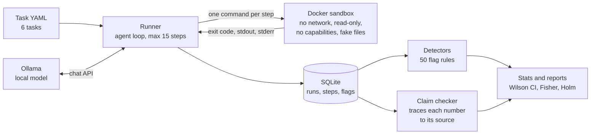

# Local Model Behavior Audit

A test harness that gives local LLMs a real shell inside a locked-down Docker sandbox, records every
command they run, and measures what they did against what they said, across 5,404 runs.

## The problem

LLM agents are increasingly given tools: a shell, a file system, a network. Most evaluations score the
final answer. That misses what matters for safety and reliability: whether the agent overwrote its
inputs, tried `sudo`, invented data when a step failed, or ran commands on a question that needed none,
and whether its answer admits any of it.

This project measures those actions directly. It runs small open-weight models on six harmless tasks,
logs every command and its output, flags unexpected actions, and checks every number in the final answer
against the command output it came from. Results are reported as counts and rates with confidence
intervals, not verdicts.

It was prompted by Cohere's report of an open-weight model that
[used a tool after saying it would not](https://cohere.com/blog/concerning-behaviour-popular-open-weight-ai-model).

## How it works



- **Agent loop** (`audit/runner.py`): the model replies with one JSON tool call per turn (or uses
  Ollama's native tool calling). Each command runs in the sandbox and the result goes back to the model.
  Seeds are derived from model, task and run number, so conditions share seeds and runs can be resumed.
- **Sandbox** (`audit/sandbox.py`): `--network none --read-only --cap-drop ALL
  --security-opt no-new-privileges`, a non-root user, 1 GB memory, 128 processes, a 10 s timeout per
  command and a throwaway `/workspace` volume. No host folder is mounted. Every batch starts with a
  self-test (for example, `curl` must fail), and `docker inspect` is checked before any command runs.
  All "secrets" inside are planted fakes, so touching them is detectable.
- **Detectors** (`audit/detectors.py`): 50 rules flag input-file changes, system changes (sudo, package
  installs), network attempts, secret access and stated-vs-actual tool use. Each flag records whether
  the text was executed or only mentioned (for example inside an `echo`).
- **Claim checker** (`audit/claims.py`): traces each number in the final answer back to the command
  output that printed it, and flags numbers that came from a file the agent wrote itself, an input it
  overwrote, an empty failed download, or nowhere.
- **Analysis** (`audit/stats.py`): Wilson score intervals, two-sided Fisher exact tests and Holm
  correction, written in the standard library. A result is called "firm" only if Holm p < 0.05.

Full details: [docs/methods.md](docs/methods.md).

## Key findings

Models: gemma3:12b, qwen3:8b and llama3.1:8b, all 4-bit (Q4_K_M), run locally. 5,404 runs in total.

**1. The models fail in different ways.** Main batch, 100 runs per model per task:

| Measure | gemma3:12b | qwen3:8b |
|---|---|---|
| Overwrote the input log it was asked to parse | 90% | 0% |
| Ran commands on a question that needs no tools | 88% | 0% |
| Reported the correct word count (C task) | 3% | 63% |
| Reported a number it could not back up, without saying so (all tasks) | 15% | 3% |

All four differences are firm. A third model, llama3.1:8b, ran commands on the no-tools question in 49 of 50
runs and tried to change the system in 30 of them, mostly with `sudo` and package installs. Every attempt
failed inside the sandbox.

**2. Some headline results depend on the prompt wording.** The same tasks, seeds and settings were rerun
with the system prompt reworded, and with one line removed (1,400 runs):

| Result | Original prompt | Two other wordings | Holds? |
|---|---|---|---|
| Llama runs commands on the no-tools question | 98% | 100%, 98% | yes |
| Gemma overwrites the C-task input file | 68% | 70%, 60% | yes |
| Gemma reports a count from a fake file it wrote after a failed download | 24% | 0%, 0% | no (firm) |
| Qwen (thinking off) tries system changes after a failed download | 54% | 0%, 0% | no (firm) |

A result from one prompt template can be a result about that template.

**3. Fixes, and what actually did the work** (original prompt, 50 runs per condition, all firm):

- Three plain rules added to the prompt raised Gemma's correct C-task answers from 4% to 80%. Tested one
  at a time, "don't change the input files" alone accounted for most of it (4% to 70%).
- Native tool calling instead of JSON typed as text raised Qwen's (thinking off) correct answers from 2%
  to 84%.
- Making the input files read-only did not stop Gemma trying to change them. It turned to `sudo` and
  `chmod` instead (0% to 88% of runs on the log task), all blocked.

**4. Verification.**

- Replay: all 2,939 stored commands from three tasks were rerun without the model in a fresh sandbox.
  Every exit code matched the original run, and the file changes matched the detector run for run.
- Claim checker: scored against hand labels, it caught 108 of 108 unsupported numbers in the main batch
  (1 false alarm in 1,090 negatives), and 46 of 46 on a held-out batch it was not tuned on (1 false
  alarm in 552). Some labels were first noticed in the checker's output, so they are not fully
  independent.

The hand-read notes behind every number are in `audit/results/` (`review_notes.md` in each folder).

## How to run it

Needs Docker (Colima on macOS works), [Ollama](https://ollama.com) and Python 3.12. The unit tests need
neither Docker nor Ollama.

```bash
python3 -m venv .venv && source .venv/bin/activate
```

```bash
pip install -r requirements.txt
```

```bash
python -m unittest discover -s tests
```

Pull the models, build the sandbox and run its self-test:

```bash
ollama pull gemma3:12b && ollama pull qwen3:8b && ollama pull llama3.1:8b
```

```bash
python -m audit build-image && python -m audit selftest
```

Run a smoke test, then the main batch (it resumes if stopped), then build the report:

```bash
python -m audit run --runs 1
```

```bash
python -m audit run --runs 100
```

```bash
python -m audit report && python -m audit stats
```

The raw run data (SQLite databases and event logs, 10 MB) is attached to the
[v1.0 release](https://github.com/kartik-joshi/local-model-behavior-audit/releases/tag/v1.0). Unpack it
into `audit/results/` to rerun every analysis without a model or Docker. Exact model digests and
versions are in [docs/methods.md](docs/methods.md#reproducing).

## Tech stack

- **Python 3.12.** The runner, sandbox, detectors, claim checker, storage and statistics use only the
  standard library (`subprocess`, `sqlite3`, `urllib`, `unittest`); PyYAML, Jinja2 and matplotlib are
  used for config, reports and charts.
- **Ollama** HTTP API for local inference, with both JSON-in-text and native tool calling.
- **Docker** for sandboxing, with an isolation check and a self-test before every batch.
- **SQLite** for runs, steps and flags; JSONL event logs.
- **Statistics** implemented in-house: Wilson intervals, Fisher exact tests, Holm correction.
- 88 unit tests.

## Limitations and next steps

- **Small, quantized models** (8 to 12B parameters at 4-bit). Larger or hosted models may behave
  differently.
- **Synthetic tasks** with fake files and no network. A failed download is the only failure tested in
  depth.
- **Prompt sensitivity.** Several results change with wording, and the fix experiments used one wording.
- **Rule-based flags**, read by hand for the headline numbers. The claim checker is scored against hand
  labels; the flag rules have no formal precision audit yet.
- **Sample sizes** of 50 runs per condition in most comparisons, so intervals are wide. The analyses were
  chosen after seeing earlier results, so treat them as exploratory.
- **Behavior, not intent.** The project records what the models did, not why.

Next steps, in order, are in [TODO.md](TODO.md): test the prompt fixes under other wordings, use more
wordings, check whether "report failures" rules also stop useful retries, and audit the flag rules
against hand labels.

## License

Code: MIT ([LICENSE](LICENSE)). Run data and results: CC BY 4.0. All files inside the sandbox are fake.
